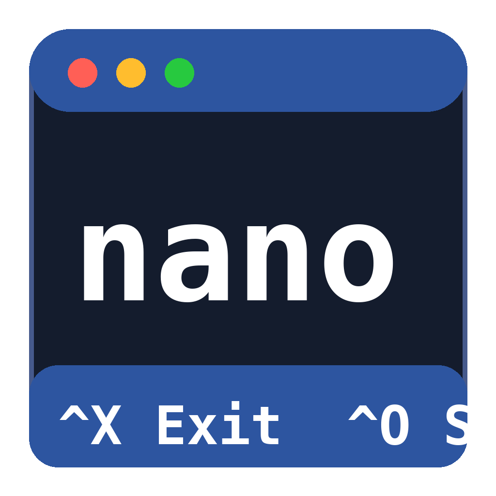

# discord-nano-rpc

Discord Rich Presence that shows you as "**Playing Nano**" (the GNU nano text editor).
It's not a real game — it's just a Rich Presence status. Nothing else.



## What it shows

- **App name:** Nano
- **Details:** `Editing in nano`
- **State:** `$ nano notes.txt`
- **Large image:** `nano` (GNU nano logo)
- **Small image:** `tux` (Linux)

## Quick start (Arch Linux)

```bash
sudo pacman -S --needed --noconfirm git python && \
git clone https://github.com/UfoFread699/discord-nano-rpc && \
cd discord-nano-rpc && ./setup.sh && ./nano.sh
```

Stop it with `Ctrl+C`.

## Manual setup

```bash
python -m venv .venv
.venv/bin/pip install -r requirements.txt
./nano.sh
```

## Discord setup (do this once)

The app name "Nano" comes from your **Discord application**, not from the code.
To make it work you need a Discord application:

1. Go to https://discord.com/developers/applications → **New Application** → name it **Nano**.
2. Copy the **Application ID** and put it into `nano_rpc.py` (`CLIENT_ID`).
3. **General Information** → **App Icon** → upload `nano.png`.
4. **Rich Presence** → **Art Assets** → upload `nano.png` (asset key **`nano`**)
   and optionally `tux.png` (asset key **`tux`**).

> The default `CLIENT_ID` in this repo is pre-filled, but you should replace it
> with your own app's ID if you want your own name/icon.

## Requirements

- Python 3
- [pypresence](https://pypi.org/project/pypresence/) (installed by `setup.sh` / `requirements.txt`)
- Discord desktop app running (not the browser version)
- In Discord: **Settings → Activity Privacy → "Display current activity as a status message"** must be ON.

## Notes

- Discord must be running on the same machine as the script.
- If the status doesn't show up, make sure you're not set to Invisible, and
  restart Discord (tray icon → Quit → relaunch) before running `./nano.sh`.
